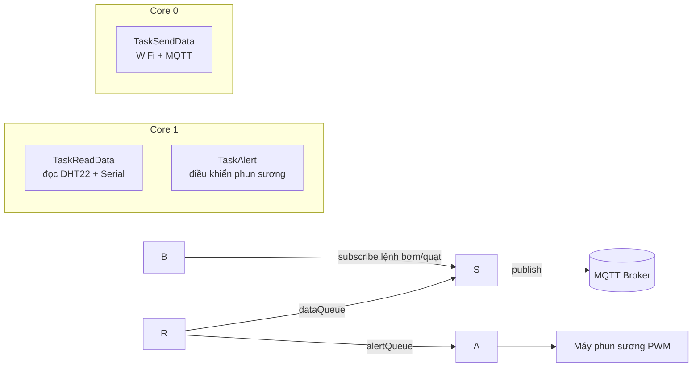

Báo cáo Lab 3: Giám sát vườn cây công nghiệp với ESP32, FreeRTOS và MQTT
Sinh viên: ……………………………
MSSV: ……………………………
Lớp: ……………………………
Đề: Đề 2 – Mạch giám sát dữ liệu môi trường vườn trồng cây công nghiệp (cà phê, hồ tiêu)
Link project Wokwi: ……………………………
Giao diện Web (GitHub Pages): https://quydat05.github.io/lab3_de2_lequydat/
---
1. Giới thiệu về RTOS và FreeRTOS
1.1. Ưu điểm của RTOS
RTOS (Real-Time Operating System) là hệ điều hành thời gian thực, đảm bảo tác vụ được thực thi trong khoảng thời gian xác định và có thể dự đoán trước.
Đa nhiệm: nhiều công việc (đọc cảm biến, gửi dữ liệu, điều khiển thiết bị) chạy song song dưới dạng các Task độc lập.
Đáp ứng thời gian thực: bộ lập lịch (scheduler) theo độ ưu tiên bảo đảm Task quan trọng được xử lý đúng hạn.
Cấu trúc code rõ ràng: chia chương trình thành các Task nhỏ, dễ viết, dễ kiểm thử, dễ mở rộng.
Sử dụng CPU hiệu quả: không dùng `delay()` chặn toàn bộ chương trình; khi một Task chờ, CPU được giao cho Task khác.
Tận dụng đa nhân: ESP32 có 2 core, có thể gán Task vào Core 0 hoặc Core 1.
1.2. Ưu điểm và nhược điểm của FreeRTOS
Ưu điểm	Nhược điểm
Miễn phí, mã nguồn mở (giấy phép MIT)	Chỉ cung cấp lõi (task, queue, semaphore, timer), không có sẵn giao diện, file system hay network stack cao cấp
Nhỏ gọn, tốn ít RAM/Flash	Mỗi Task cần một vùng stack riêng, tốn RAM nếu tạo nhiều Task
Dễ port, tích hợp sẵn trong ESP32 (ESP-IDF, Arduino)	Dễ gặp lỗi đồng bộ (race condition, deadlock, đảo ngược ưu tiên) nếu thiết kế kém
Cộng đồng lớn, nhiều tài liệu	Khó gỡ lỗi hơn chương trình tuần tự; cần hiểu về lập lịch và độ ưu tiên
2. Cơ chế giao tiếp giữa các Task
2.1. Cờ hiệu (Semaphore / Mutex)
Semaphore dùng để báo hiệu và đồng bộ giữa các Task. Hai dạng thường dùng: Binary Semaphore (báo hiệu sự kiện) và Mutex (khóa tài nguyên dùng chung, có kế thừa độ ưu tiên).
Ưu điểm: đơn giản, nhẹ; ngăn nhiều Task truy cập cùng lúc vào một tài nguyên.
Hạn chế: chỉ báo hiệu hoặc khóa, không mang dữ liệu; dùng sai có thể gây deadlock.
Ứng dụng: bảo vệ cổng Serial khi nhiều Task cùng in; báo hiệu sự kiện từ ngắt; bảo vệ biến dùng chung.
2.2. Hàng đợi (Queue)
Queue là hàng đợi FIFO để truyền dữ liệu giữa các Task. Dữ liệu được sao chép vào Queue nên Task gửi và Task nhận tách rời nhau.
Ưu điểm: an toàn khi nhiều Task/nhiều Core truy cập; Task nhận có thể chờ đến khi có dữ liệu; có timeout; không cần biến toàn cục.
Hạn chế: tốn RAM theo kích thước và số phần tử; Queue đầy thì dữ liệu mới có thể bị mất.
Ứng dụng: truyền dữ liệu cảm biến sang Task gửi MQTT; gửi lệnh điều khiển; gom log từ nhiều Task.
Tiêu chí	Semaphore / Mutex	Queue
Mục đích	Đồng bộ, khóa tài nguyên	Truyền dữ liệu
Mang dữ liệu	Không	Có
Trong bài này	`serialMutex` bảo vệ Serial	`dataQueue`, `alertQueue`
3. Các bước thực hiện bài Lab
3.1. Đề bài
Thiết kế mạch giám sát môi trường vườn cây công nghiệp dùng ESP32 đọc nhiệt độ, độ ẩm từ DHT22, hiển thị qua Serial, đồng thời gửi lên MQTT Broker qua WiFi và hiển thị trên Web. Vườn cần độ ẩm ổn định 40% – 60%; máy phun sương bật khi độ ẩm dưới ngưỡng theo thuật toán của đề. Hệ thống xây dựng bằng FreeRTOS với ba Task.
3.2. Sơ đồ mạch trong Wokwi
Linh kiện: ESP32 DevKit, cảm biến DHT22, 3 LED (mô phỏng Máy bơm, Quạt, Máy phun sương), 3 điện trở 220Ω. Ngoài thực tế, các thiết bị công suất điều khiển qua relay hoặc MOSFET.
Linh kiện	Chân linh kiện	Chân ESP32	Ghi chú
DHT22	VCC	3V3	Nguồn
DHT22	SDA (DATA)	GPIO 4	Dữ liệu
DHT22	GND	GND	
LED Máy bơm (xanh dương)	Anode (qua 220Ω)	GPIO 26	Bật/tắt
LED Quạt (xanh lá)	Anode (qua 220Ω)	GPIO 27	Bật/tắt
LED Máy phun sương (đỏ)	Anode (qua 220Ω)	GPIO 25	PWM 5 kHz, 8 bit
3 LED	Cathode	GND	

3.3. Triển khai FreeRTOS trên ESP32
Hệ thống gồm 3 Task, 2 Queue và 1 Mutex.

Bảng dữ liệu cho các Task
Task	Core	Ưu tiên	Nhiệm vụ	Dữ liệu vào/ra
TaskSendData (Task truyền data)	0	1	Kết nối WiFi, MQTT; khi thành công thì đọc `dataQueue` và publish lên Broker; nhận lệnh bơm/quạt	Vào: `dataQueue`. Ra: MQTT topic data
TaskReadData (Task đọc data)	1	2	Đọc DHT22 mỗi 2 giây, in Serial, gửi dữ liệu đầy đủ vào `dataQueue` và độ ẩm vào `alertQueue`	Ra: `dataQueue`, `alertQueue`
TaskAlert (Task cảnh báo)	1	2	Đọc `alertQueue`, điều khiển công suất máy phun sương theo thuật toán	Vào: `alertQueue`. Ra: PWM GPIO 25

Đối tượng	Kiểu phần tử	Mục đích
`dataQueue` (10 phần tử)	`struct SensorData {temp, hum}`	Truyền nhiệt độ, độ ẩm từ TaskReadData sang TaskSendData
`alertQueue` (5 phần tử)	`float` (độ ẩm)	Truyền độ ẩm sang TaskAlert
`serialMutex`	Mutex	Chỉ một Task in Serial tại một thời điểm
Thuật toán máy phun sương (theo đề)
Độ ẩm (H)	Công suất máy	Thời gian phun
35% ≤ H < 40%	25%	10 giây
30% ≤ H < 35%	50%	20 giây
H < 30%	100%	30 giây
H ≥ 40%	Tắt	–
3.4. Giao diện Web
Trang web (`index.html`) kết nối MQTT Broker qua WebSocket bằng MQTT.js, gồm:
2 thẻ HTML hiển thị nhiệt độ, độ ẩm dạng số (class `temp`, `hum`);
2 biểu đồ Chart.js cập nhật nhiệt độ, độ ẩm theo thời gian thực (giữ 30 điểm gần nhất);
1 thẻ công suất phun sương, kèm thanh tiến trình và số giây còn lại;
thẻ độ ẩm đổi màu theo trạng thái (ổn định, hơi khô, rất khô) và đường ngưỡng 40% trên biểu đồ;
2 nút button điều khiển Máy bơm và Quạt (chế độ manual).
Topic	Hướng	Nội dung
`hotenlop/vuon/data`	ESP32 → Web	JSON `{"temp":..,"hum":..,"mist":..,"left":..}`
`hotenlop/vuon/cmd/pump`	Web → ESP32	`"1"` bật, `"0"` tắt máy bơm
`hotenlop/vuon/cmd/fan`	Web → ESP32	`"1"` bật, `"0"` tắt quạt

3.5. Giải thích code
Toàn bộ code ở mục 6 (hoặc file `sketch.ino`, `index.html`).
a) Khởi tạo (`setup`). Khởi động Serial và DHT22, cấu hình chân bơm/quạt là OUTPUT, cấu hình PWM 5 kHz, 8 bit cho chân máy phun sương bằng `ledcAttach`. Tạo hai Queue bằng `xQueueCreate`, Mutex bằng `xSemaphoreCreateMutex`, và ba Task bằng `xTaskCreatePinnedToCore` với tham số cuối là số Core (0 hoặc 1) để gán đúng nhân theo đề. Hàm `loop()` chỉ gọi `vTaskDelay` vì mọi việc đã nằm trong các Task.
b) Tạo kết nối (TaskSendData, Core 0). Task gọi `WiFi.begin` rồi chờ `WiFi.status() == WL\_CONNECTED` (dùng `vTaskDelay` để nhường CPU). Khi WiFi thành công, Task cấu hình MQTT Broker (`broker.hivemq.com`, cổng 1883), đăng ký `mqttCallback`, gọi `mqttReconnect` để kết nối và subscribe hai topic lệnh pump, fan. Mất WiFi thì `WiFi.reconnect`; mất MQTT thì tự kết nối lại.
c) Cập nhật dữ liệu. TaskReadData đọc DHT22 mỗi 2 giây (giới hạn tốc độ của DHT22), kiểm tra `isnan` để loại giá trị lỗi, in Serial (được bảo vệ bởi `serialMutex`), rồi `xQueueSend` dữ liệu đầy đủ vào `dataQueue` và độ ẩm vào `alertQueue`. TaskSendData dùng `xQueueReceive` lấy dữ liệu, đóng gói JSON bằng `snprintf` và `mqtt.publish` lên topic data. Phía web, MQTT.js nhận bản tin, `JSON.parse` rồi cập nhật hai thẻ số và đẩy điểm mới vào hai biểu đồ.
d) Điều khiển tự động (TaskAlert, Core 1). Task chờ độ ẩm từ `alertQueue` (timeout 100 ms). Độ ẩm < 30% thì phun 100% trong 30 s; < 35% thì 50% trong 20 s; < 40% thì 25% trong 10 s; từ 40% trở lên thì tắt ngay. Công suất đặt bằng PWM (`ledcWrite`), có hiệu chỉnh gamma để mắt người phân biệt rõ 25%, 50%, 100%. Thời gian phun tính bằng `millis()` thay vì `delay()` để Task không bị treo. Mỗi lần nhận độ ẩm, Task in ra Serial một dòng quyết định (ví dụ `DO AM DUOI 30%: PHUN 100% TRONG 30 GIAY!`) và gửi số giây còn lại lên web.
e) Điều khiển thủ công. Khi bấm nút trên web, trình duyệt publish `"1"` hoặc `"0"` lên topic `cmd/pump` hoặc `cmd/fan`. ESP32 nhận trong `mqttCallback` (chạy trong TaskSendData qua `mqtt.loop`) và `digitalWrite` bật/tắt chân tương ứng.
f) Lưu ý thiết kế. Chỉ TaskSendData dùng đối tượng MQTT vì `PubSubClient` không an toàn khi dùng từ nhiều Task. Dữ liệu giữa hai Core truyền hoàn toàn qua Queue nên không cần biến toàn cục chia sẻ.
4. Kết quả đạt được
Hình 3: Serial Monitor hiển thị nhiệt độ, độ ẩm và quyết định phun sương

Hình 4: LED máy phun sương ở các mức công suất
Độ ẩm 38% – công suất 25%	Độ ẩm 32% – công suất 50%	Độ ẩm 24% – công suất 100%
		
Hình 5: Web cập nhật dữ liệu và biểu đồ thời gian thực

Hình 6: Bấm nút trên web, LED máy bơm/quạt thay đổi trạng thái

Link project Wokwi: ……………………………
Video demo (nếu có): ……………………………
5. Kết luận
Bài Lab xây dựng hệ thống giám sát vườn cây công nghiệp trên ESP32 bằng FreeRTOS với ba Task chạy trên hai Core, giao tiếp qua Queue và Mutex, gửi dữ liệu lên MQTT Broker và hiển thị, điều khiển từ Web. Việc tách chức năng thành các Task giúp hệ thống ổn định, không bị chặn bởi kết nối mạng, và thuật toán phun sương theo ngưỡng độ ẩm hoạt động đúng yêu cầu của đề.
6. Mã nguồn
<details>
<summary><b>sketch.ino</b> (code ESP32)</summary>
```cpp
#include <WiFi.h>
#include <PubSubClient.h>
#include <DHT.h>

// ---------- Cau hinh ----------
const char\* WIFI\_SSID = "Wokwi-GUEST";
const char\* WIFI\_PASS = "";
const char\* MQTT\_HOST = "broker.hivemq.com";
const int   MQTT\_PORT = 1883;

// Doi "hotenlop" thanh ho ten-lop cua ban (phai trung voi index.html)
#define T\_DATA  "hotenlop/vuon/data"
#define T\_PUMP  "hotenlop/vuon/cmd/pump"
#define T\_FAN   "hotenlop/vuon/cmd/fan"

#define DHTPIN   4
#define DHTTYPE  DHT22
#define PUMP\_PIN 26
#define FAN\_PIN  27
#define MIST\_PIN 25

DHT dht(DHTPIN, DHTTYPE);
WiFiClient espClient;
PubSubClient mqtt(espClient);

struct SensorData { float temp; float hum; };

QueueHandle\_t dataQueue;       // du lieu day du (temp + hum)
QueueHandle\_t alertQueue;      // chi do am
SemaphoreHandle\_t serialMutex; // bao ve Serial

volatile int mistPercent = 0;  // cong suat phun suong (0-100)
volatile int mistLeft    = 0;  // so giay phun con lai

// Mat nguoi nhin do sang LED khong tuyen tinh, nen dung hieu chinh gamma
// de 25% / 50% / 100% nhin khac nhau ro rang. Dat 0 de dung PWM tuyen tinh.
#define USE\_GAMMA 1

// ---------- MQTT nhan lenh (manual) ----------
void mqttCallback(char\* topic, byte\* payload, unsigned int len) {
  bool on = (len > 0 \&\& payload\[0] == '1');
  if (strcmp(topic, T\_PUMP) == 0) digitalWrite(PUMP\_PIN, on);
  if (strcmp(topic, T\_FAN)  == 0) digitalWrite(FAN\_PIN,  on);
}

void mqttReconnect() {
  while (!mqtt.connected()) {
    String id = "esp32-" + String(random(0xffff), HEX);
    if (mqtt.connect(id.c\_str())) {
      mqtt.subscribe(T\_PUMP);
      mqtt.subscribe(T\_FAN);
    } else vTaskDelay(2000 / portTICK\_PERIOD\_MS);
  }
}

// ---------- TASK TRUYEN DATA (Core 0) ----------
void TaskSendData(void\* pv) {
  WiFi.begin(WIFI\_SSID, WIFI\_PASS);
  while (WiFi.status() != WL\_CONNECTED) vTaskDelay(500 / portTICK\_PERIOD\_MS);

  mqtt.setServer(MQTT\_HOST, MQTT\_PORT);
  mqtt.setCallback(mqttCallback);

  SensorData d;
  for (;;) {
    if (WiFi.status() == WL\_CONNECTED) {
      if (!mqtt.connected()) mqttReconnect();
      mqtt.loop();
      if (xQueueReceive(dataQueue, \&d, 100 / portTICK\_PERIOD\_MS) == pdTRUE) {
        char msg\[96];
        snprintf(msg, sizeof(msg),
                 "{\\"temp\\":%.1f,\\"hum\\":%.1f,\\"mist\\":%d,\\"left\\":%d}",
                 d.temp, d.hum, mistPercent, mistLeft);
        mqtt.publish(T\_DATA, msg);
      }
    } else {
      WiFi.reconnect();
      vTaskDelay(1000 / portTICK\_PERIOD\_MS);
    }
  }
}

// ---------- TASK DOC DATA (Core 1) ----------
void TaskReadData(void\* pv) {
  SensorData d;
  for (;;) {
    d.temp = dht.readTemperature();
    d.hum  = dht.readHumidity();

    if (!isnan(d.temp) \&\& !isnan(d.hum)) {
      if (xSemaphoreTake(serialMutex, portMAX\_DELAY)) {
        Serial.println("===== DU LIEU CAM BIEN =====");
        Serial.printf("Nhiet do: %.2f do C\\n", d.temp);
        Serial.printf("Do am: %.2f %%\\n", d.hum);
        Serial.println("==============================");
        xSemaphoreGive(serialMutex);
      }
      xQueueSend(dataQueue,  \&d,     0);
      xQueueSend(alertQueue, \&d.hum, 0);
    }
    vTaskDelay(2000 / portTICK\_PERIOD\_MS);
  }
}

// ---------- TASK CANH BAO (Core 1) ----------
void setMist(int percent) {
  mistPercent = percent;
#if USE\_GAMMA
  int duty = (int)(255.0 \* pow(percent / 100.0, 2.2) + 0.5);
#else
  int duty = map(percent, 0, 100, 0, 255);
#endif
  ledcWrite(MIST\_PIN, duty);
}

void logLine(const char\* text) {
  if (xSemaphoreTake(serialMutex, portMAX\_DELAY)) {
    Serial.println(text);
    xSemaphoreGive(serialMutex);
  }
}

void TaskAlert(void\* pv) {
  float hum;
  unsigned long endTime = 0;
  for (;;) {
    if (xQueueReceive(alertQueue, \&hum, 100 / portTICK\_PERIOD\_MS) == pdTRUE) {
      int power = 0; unsigned long dur = 0;
      const char\* msg;
      if (hum >= 40) {
        msg = "DO AM >= 40%: TAT MAY PHUN SUONG!";
      } else if (hum >= 35) {
        power = 25;  dur = 10000;
        msg = "DO AM TU 35% DEN DUOI 40%: PHUN 25% TRONG 10 GIAY!";
      } else if (hum >= 30) {
        power = 50;  dur = 20000;
        msg = "DO AM TU 30% DEN DUOI 35%: PHUN 50% TRONG 20 GIAY!";
      } else {
        power = 100; dur = 30000;
        msg = "DO AM DUOI 30%: PHUN 100% TRONG 30 GIAY!";
      }

      if (power == 0) {
        setMist(0);                          // du am -> tat ngay
        mistLeft = 0;
      } else if (power != mistPercent) {     // doi muc cong suat -> bat dau tinh gio moi
        setMist(power);
        endTime = millis() + dur;
      }
      logLine(msg);
    }
    if (mistPercent > 0) {
      if (millis() >= endTime) {
        setMist(0);
        mistLeft = 0;
        logLine("HET GIO PHUN: TAT MAY PHUN SUONG!");
      } else {
        mistLeft = (endTime - millis() + 999) / 1000;
      }
    }
  }
}

// ---------- SETUP ----------
void setup() {
  Serial.begin(115200);
  dht.begin();
  pinMode(PUMP\_PIN, OUTPUT);
  pinMode(FAN\_PIN,  OUTPUT);

  // Arduino-ESP32 core 3.x. Neu bao loi (core 2.x) dung:
  //   ledcSetup(0, 5000, 8); ledcAttachPin(MIST\_PIN, 0); va ledcWrite(0, duty)
  ledcAttach(MIST\_PIN, 5000, 8);

  dataQueue   = xQueueCreate(10, sizeof(SensorData));
  alertQueue  = xQueueCreate(5,  sizeof(float));
  serialMutex = xSemaphoreCreateMutex();

  xTaskCreatePinnedToCore(TaskSendData, "SendData", 8192, NULL, 1, NULL, 0); // Core 0
  xTaskCreatePinnedToCore(TaskReadData, "ReadData", 4096, NULL, 2, NULL, 1); // Core 1
  xTaskCreatePinnedToCore(TaskAlert,    "Alert",    4096, NULL, 2, NULL, 1); // Core 1
}

void loop() { vTaskDelay(portMAX\_DELAY); }
```
</details>
<details>
<summary><b>index.html</b> (giao diện Web)</summary>
```html
<!DOCTYPE html>
<html lang="vi">
<head>
<meta charset="UTF-8">
<meta name="viewport" content="width=device-width, initial-scale=1">
<title>Giám sát vườn cây công nghiệp</title>
<script src="https://unpkg.com/mqtt@5.10.1/dist/mqtt.min.js"></script>
<script src="https://cdn.jsdelivr.net/npm/chart.js@4.4.3/dist/chart.umd.min.js"></script>
<style>
  :root{--bg:#f3f6f1;--ink:#1d2b22;--card:#fff;--line:#d6dfd3;--ok:#2e7d4f;--off:#8a948c}
  \*{box-sizing:border-box}
  body{font-family:"Times New Roman",Arial,sans-serif;background:var(--bg);color:var(--ink);max-width:960px;margin:0 auto;padding:20px 14px}
  h1{font-size:26px;margin:0 0 4px}
  #status{margin:0 0 18px;color:var(--off);font-family:Arial,sans-serif;font-size:14px}
  .row{display:grid;grid-template-columns:repeat(auto-fit,minmax(240px,1fr));gap:14px;margin-bottom:14px}
  .card{background:var(--card);border:1px solid var(--line);border-radius:6px;padding:16px}
  .label{font-family:Arial,sans-serif;font-size:14px;color:var(--off)}
  .value{font-size:44px;font-weight:bold;margin-top:4px}
  button{font:16px Arial,sans-serif;padding:12px 22px;border:0;border-radius:6px;cursor:pointer;color:#fff;background:var(--off);margin-right:10px}
  button.on{background:var(--ok)}
  .card.dry{border-color:#e6a23c;background:#fff8ec}
  .card.vdry{border-color:#e53935;background:#fff0ef}
  .card.good{border-color:#2e7d4f}
  .badge{display:inline-block;margin-top:8px;padding:4px 10px;border-radius:12px;font:14px Arial,sans-serif;color:#fff;background:var(--ok)}
  .badge.dry{background:#e6a23c}.badge.vdry{background:#e53935}
  .bar{height:14px;background:#e4e9e3;border-radius:7px;margin-top:10px;overflow:hidden}
  .bar>div{height:100%;width:0;background:#1e88e5;transition:width .4s}
  .mistText{font:14px Arial,sans-serif;margin-top:6px}
  .rule{font:13px Arial,sans-serif;color:var(--off);margin:0 0 14px}
  button:focus-visible{outline:3px solid #1e88e5;outline-offset:2px}
</style>
</head>
<body>
<h1>Giám sát vườn cà phê / hồ tiêu</h1>
<p id="status">Đang kết nối broker...</p>

<div class="row">
  <div class="card"><div class="label">Nhiệt độ</div><div class="value"><span class="temp">--</span> °C</div></div>
  <div class="card" id="humCard"><div class="label">Độ ẩm (cần giữ 40% – 60%)</div><div class="value"><span class="hum">--</span> %</div><span class="badge" id="humBadge">Chờ dữ liệu</span></div>
  <div class="card"><div class="label">Công suất phun sương</div><div class="value"><span class="mist">--</span> %</div><div class="bar"><div id="mistBar"></div></div><div class="mistText" id="mistText">Chờ dữ liệu</div></div>
</div>

<p class="rule">Quy tắc phun sương: độ ẩm 35–40% → 25% trong 10 s · 30–35% → 50% trong 20 s · dưới 30% → 100% trong 30 s</p>
<div class="row">
  <div class="card"><canvas id="chartTemp"></canvas></div>
  <div class="card"><canvas id="chartHum"></canvas></div>
</div>

<div class="card">
  <div class="label" style="margin-bottom:10px">Điều khiển thủ công</div>
  <button id="btnPump" onclick="toggle('pump')">Máy bơm: TẮT</button>
  <button id="btnFan" onclick="toggle('fan')">Quạt: TẮT</button>
</div>

<script>
const PREFIX = "hotenlop/vuon";   // phải trùng với code ESP32
const client = mqtt.connect("wss://broker.hivemq.com:8884/mqtt");
const state = {pump:false, fan:false};

client.on("connect", () => {
  document.getElementById("status").textContent = "Đã kết nối broker";
  client.subscribe(PREFIX + "/data");
});
client.on("error", () => {
  document.getElementById("status").textContent = "Lỗi kết nối broker";
});

function makeChart(id, label, color){
  return new Chart(document.getElementById(id), {
    type:"line",
    data:{labels:\[], datasets:\[{label, data:\[], borderColor:color, tension:.3}]},
    options:{animation:false}
  });
}
const cT = makeChart("chartTemp","Nhiệt độ (°C)","#e53935");
const cH = makeChart("chartHum","Độ ẩm (%)","#1e88e5");
cH.data.datasets.push({label:"Ngưỡng 40%", data:\[], borderColor:"#e6a23c", borderDash:\[6,4], pointRadius:0});
cH.options.scales = {y:{min:0, max:100}};

function push(chart, v){
  chart.data.labels.push(new Date().toLocaleTimeString());
  chart.data.datasets\[0].data.push(v);
  if(chart.data.datasets\[1]) chart.data.datasets\[1].data.push(40);
  if(chart.data.labels.length > 30){ chart.data.labels.shift(); chart.data.datasets.forEach(ds => ds.data.shift()); }
  chart.update();
}

client.on("message", (topic, payload) => {
  const d = JSON.parse(payload.toString());
  document.querySelector(".temp").textContent = d.temp;
  document.querySelector(".hum").textContent  = d.hum;
  document.querySelector(".mist").textContent = d.mist;
  push(cT, d.temp); push(cH, d.hum);
  showHumidity(d.hum);
  showMist(d.mist, d.left);
});

function showHumidity(h){
  const card = document.getElementById("humCard"), badge = document.getElementById("humBadge");
  card.className = "card"; badge.className = "badge";
  if (h >= 40)      { card.classList.add("good"); badge.textContent = "Độ ẩm ổn định"; }
  else if (h >= 30) { card.classList.add("dry");  badge.classList.add("dry");  badge.textContent = "Hơi khô – cần phun sương"; }
  else              { card.classList.add("vdry"); badge.classList.add("vdry"); badge.textContent = "Rất khô – phun tối đa"; }
}
function showMist(p, left){
  document.getElementById("mistBar").style.width = p + "%";
  document.getElementById("mistText").textContent =
    p > 0 ? "Đang phun " + p + "% – còn " + left + " giây" : "Máy phun sương đang tắt";
}

function toggle(dev){
  state\[dev] = !state\[dev];
  client.publish(PREFIX + "/cmd/" + dev, state\[dev] ? "1" : "0");
  const b = document.getElementById(dev === "pump" ? "btnPump" : "btnFan");
  b.textContent = (dev === "pump" ? "Máy bơm: " : "Quạt: ") + (state\[dev] ? "BẬT" : "TẮT");
  b.classList.toggle("on", state\[dev]);
}
</script>
</body>
</html>
```
</details>
